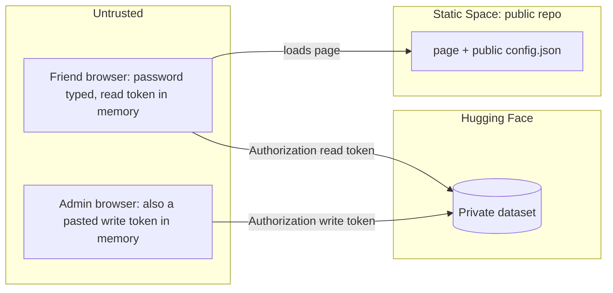
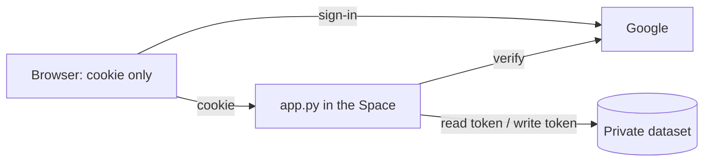

# ARCHITECTURE

> **TL;DR** CURRENT plan (static mode, D25): a private HF dataset (clips + data), a free STATIC Space (page + public encrypted config; `site/hfstatic`, in progress), and the browser talking to the Hub directly. No server, no Google. SERVER mode (FastAPI proxy, Google sign-in, roles) is a saved option (D27), built and mock-tested but not deployed. Names of secrets are listed here; values never.

## Components (current plan: static mode)
| Component | What | Where |
|---|---|---|
| Private dataset | `Soverellp/clip-vault`: `index.json`, `clips/<id>.mp4`, `clips/<id>.jpg` (admin mode and server mode add `users.json`, `trash/clips/`, `_audit/`) | https://huggingface.co/datasets/Soverellp/clip-vault |
| Static Space | `Soverellp/clip-vault-site`, public, SDK static (free). Created EMPTY on 2026-11-17 through the API (D24). Holds only the built page and its PUBLIC config (the read token encrypted with the gate password). No clips | https://soverellp-clip-vault-site.hf.space |
| Page | `site/hfstatic` (IN PROGRESS, not deployed; README there when present): password gate (PBKDF2 + AES-GCM, same idea as the old `site/hfvault` page), library, player, admin mode using the Hub API from the browser | clipper repo |
| Uploader | `build_hfvault.py --upload` through `with_vault_creds.py` | clipper repo |
| Credential store | the Claude environment variables (preferred), or until retired `Kagglegpu1.pdf` in private Kaggle dataset `arvr7plays/kagglegpu1` read only by `with_vault_creds.py` | Claude / Kaggle |
| Password manager | recommended master copy of every token and the gate password | user |

## Trust boundaries (static mode)

- The config on the Space is PUBLIC. It holds only ciphertext. Anyone can try passwords against it offline (D26): the password is a short human one the user chose and accepted the risk for. Whoever knows the password can read the read token in browser tools and pass it on (known limit, same as D4).
- The read token must be a dedicated, revocable, read-only, one-dataset token (for now `Clip_vault_HFToken` is reused; a dedicated one is planned). The admin write token is NEVER in the page, config, Space or repo; it is pasted per session and kept in memory.
- No Google, no cookies, no per-person accounts, no server logs: access control is one shared password. Nothing here is security-reviewed (D30).
- A friend can always download and share clips they can see.

## Secrets and configuration (NAMES only; who sets them)
| Name | Kind | Used in | Notes |
|---|---|---|---|
| `HF_Token` | WRITE token of account `Soverellp` | upload and static deploy | Claude environment or wrapper (file key `HF_Tokem`, typo kept); never in the page or Space |
| `VAULT_READ_TOKEN` (file line `Clip_vault_HFToken`) | READ-only, one dataset | static build input: encrypted into the public config | reuse for now; make a dedicated read token later (D26) |
| gate password | a short human password the user chose and accepted the risk for | static build input and the page | never written anywhere; password manager |
| admin write token | fine-grained, dataset only, user-made | pasted in the browser, memory only | never in a file, env var or chat |
| `HF_Token_backup` | OLD account `Arvr7` token | nobody | to be revoked (D19) |
| `KAGGLE_USERNAME`, `KAGGLE_APITOKEN` | Claude environment | wrapper, Kaggle jobs | wrapper maps to `KAGGLE_API_TOKEN` |
| `VAULT_PASSPHRASE` | wrapper's own check | `with_vault_creds.py` | a throw-away value satisfies it; the real gate password is NOT this variable unless the static build says so (UNVERIFIED until `site/hfstatic` lands) |

Static mode has NO Space secrets and no Space variables. Server-mode-only names are in the next section.

## Code locations (where code lives TODAY, in the clipper repo)
| Path | What | State |
|---|---|---|
| `site/hfstatic/` | the static page and its build (current plan) | IN PROGRESS; did not exist yet when this table was written; link its README when present |
| `site/hfspace/` | server mode: `app.py`, `admin.py`, `auth.py`, `store.py`, `common.py`, `static/` (modern UI), `Dockerfile`, `deploy_space.py`, `SETUP.md`, `tests/` | built, mock-tested, NOT deployed (saved option) |
| `site/hfvault/` | STILL USED: `build_hfvault.py` (upload), `with_vault_creds.py` (credential injection), tests. NOT used: its old `index.html`, `app.js`, `style.css` (passphrase page, replaced by `site/hfstatic`) | in use |
| `site/vault/`, `site/share/` | rejected alternatives (D3, D2) | not used |
| `migration-setup/CLIP-VAULT.md` | all-in-one runbook for a new Claude session (static mode current) | maintained |
| `docs/site/` | `CLIP-VAULT-PAGE-PROMPT.md`, `SITE-PROMPT.md`: both SUPERSEDED prompts | history |

When code moves to `soverellp/clip-vault`, update this table and add a line to [CHANGELOG.md](CHANGELOG.md).

---
# SAVED OPTION: server mode (D27)

## Components
| Component | What |
|---|---|
| Space | Docker Space on a host that can run Python (paid HF Space, D23, or a Cloudflare Worker port, D31); port 7860, non-root uid 1000; serves `static/` plus the API; holds no clips |
| Login | Google Identity Services; the server verifies the ID token and a nonce (`auth.py`). Client id public, see [GOOGLE-CONFIG.md](GOOGLE-CONFIG.md) |
| Store | `store.py` is the only module that holds the write token and mutates the dataset: one commit per change with `parent_commit`, audit line in the same commit |

- Browser <-> Space: only a signed HttpOnly `__Host-cv_session` cookie (8 h) plus a CSRF token for state changes; strict CSP allowing only Google's sign-in script origin.
- Space <-> dataset: read token (viewers) and a separate write token (admin actions, D18); both are Space secrets. Without the write token the site is read-only (`503 read_only`).
- The Space repo would be PUBLIC: `deploy_space.py` uploads an allow-list of files only.

## Server-mode secrets (NAMES only; D22, D29)
Space secrets are WRITE-ONLY (no read-back): rotate by creating a new token and setting it again. The user enters the write token directly in the Space settings; Claude never sees it (D29).
| Name | Kind | Notes |
|---|---|---|
| `VAULT_READ_TOKEN` | Space secret | read-only, ONE dataset; differs from `HF_Token` |
| `VAULT_WRITE_TOKEN` | Space secret, optional | fine-grained, dataset only; the code refuses a value equal to the read token; `deploy_space.py` refuses one equal to `HF_Token` |
| `SESSION_SECRET` | Space secret | at least 32 characters, signs cookies; random if unset in the deploy |
| `VAULT_DATASET` | Space secret | default `Soverellp/clip-vault` |
| `ADMIN_EMAILS` | Space secret | root admins, cannot be changed from the site; entries `email` or `email:sub` |
| `ALLOWED_EMAILS` | Space secret, optional | extra viewers; others live in `users.json` in the dataset |
| `GOOGLE_CLIENT_ID` | Space VARIABLE (public) | not a secret |
| `SESSIONS_NOT_BEFORE` | optional | unix seconds; revokes earlier sessions |
The old v1 names (`ALLOWED_HF_USERS`, `OAUTH_*`, `OPENID_PROVIDER_URL`, `SPACE_HOST`) are no longer used by the code.

## Dependencies and build
`requirements.txt` is a full hash-locked lock installed with `--require-hashes --no-deps`; base image `python:3.11-slim` pinned by digest; ffmpeg (ffprobe) from Debian at build time. The versions in `requirements.in` were not re-read for this note. A real Docker build was never run (UNTESTED).
