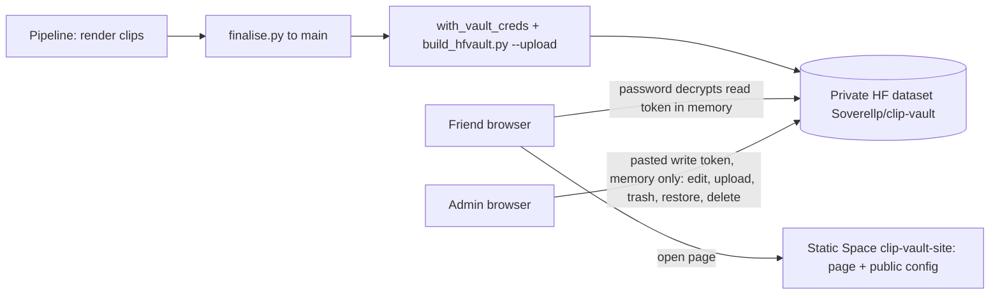
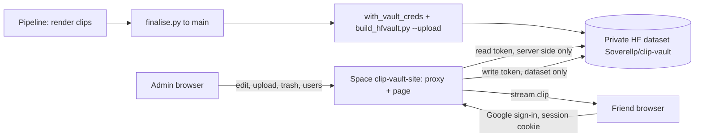
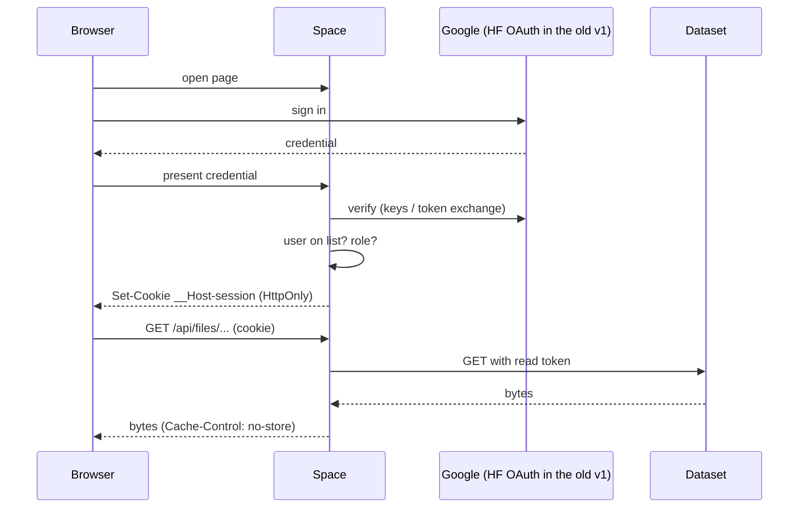
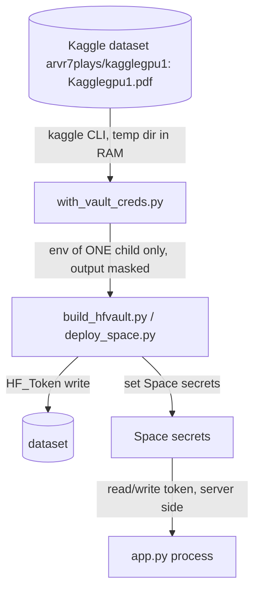

# FLOW

> **TL;DR** CURRENT plan (static mode, D25; uploads may use the account token per D38): clip -> `finalise.py` -> main -> `with_vault_creds.py` + `build_hfvault.py --upload` -> private dataset; friends open the static Space, type the shared password, the page decrypts a read-only token in memory and reads the dataset from the Hub. The admin pastes a write token (memory only) to manage clips. Server mode (Google sign-in, FastAPI proxy) is a SAVED OPTION, kept in sections S1-S7 below. Newest flow changes go at the TOP of "Flow change log".

Legend: **static** = current plan, `site/hfstatic`, IN PROGRESS (not yet deployed, not security-reviewed). **S-sections** = server mode, `site/hfspace`, built and mock-tested, not deployed (D27).

## Flow change log (newest first)
| Date | Change | Decision |
|---|---|---|
| 2026-11-18 | Library data: every stream gets `docs/vault_meta.json` (group, variant, reaction, tier, rank, why, hook per clip) and `thumb.jpg` BEFORE `vault_sync`; new clips carry the fields; `vault_sync.py --meta-only` (dry run, then `--yes`) fills the index of clips already uploaded: `streams[]`, thumbnails, fields, in one commit, then verifies; admin edits stay | D39 |
| 2026-11-18 | Clip uploads: `vault_sync.py` may use the account-wide token for all future uploads (`--allow-account-token`, user's choice); flow is dry run, show the list, then `--yes` detached with a log; 28 Kai Cenat clips (14 x with-girl + clean, about 400 MB) uploaded in 10 commits, live site shows 46 clips / 917 MB | D38 |
| 2026-11-18 | Unlock screen has "Remember on this device" (default on): the passphrase is kept in localStorage `cv.pass`, the next visit unlocks silently, Lock forgets, idle only drops the admin token | D37 |
| 2026-11-18 | Wrapper runs only 4 allow-listed scripts; static page locks after 15 min idle; deploy removes stale files; `vault_sync.py` needs `--allow-account-token` for the account token; to cut someone off rotate password AND read token | D34 |
| 2026-11-17 | Optional later backends: GitHub Actions admin backend, Cloudflare Workers | D31 |
| 2026-11-17 | Secrets policy: Space secrets only for a server app; Claude/deploy credentials stay in the Claude environment or the wrapper | D29 |
| 2026-11-17 | Server mode kept as a saved option; Google config recorded in GOOGLE-CONFIG.md | D27, D28 |
| 2026-11-17 | User chose a short human gate password and accepted the offline-guessing risk | D26 |
| 2026-11-17 | CURRENT flow = static Space + password gate + in-browser admin mode (no server, no Google) | D25 |
| 2026-11-17 | Static Space `Soverellp/clip-vault-site` created empty and public | D24 |
| 2026-11-17 | Docker/Gradio Spaces need PRO (HTTP 402): static only for now | D23 |
| 2026-11-17 | Runtime secrets are Space secrets (write-only); server mode only | D22 |
| 2026-11-17 | Login = Google on the proxy; admin flows, trash, step-up added (server mode) | D11-D14 |
| 2026-11-17 | Space became a proxy; token never reaches a browser (server mode) | D9 |
| 2026-11-17 | Login moved Google -> Hugging Face OAuth (reversed later) | D8, D11 |
| 2026-11-17 | First design: Google ID token releases read token to browser | D7 |
| 2026-11-17 | Passphrase page replaced by a server (D5, D6); revived as the static gate | D4, D5, D6, D25 |

## 0. CURRENT flow: static mode (`site/hfstatic`, in progress)

Clip to friend, numbered:
1. Render, then `finalise.py --stream streams/<s>` (dry run) and `--yes` (clips reach `main`).
2. Upload: `python3 site/hfvault/with_bw_creds.py -- python3 site/hfvault/build_hfvault.py <scratch>/vault Soverellp/clip-vault --upload` (merges `index.json` by clip id).
3. Build and deploy the static page (`site/hfstatic`, IN PROGRESS: see its README when present): the build encrypts the read token with the gate password into a PUBLIC config and uploads the page plus that config to the Static Space. A short human password needs the explicit flag `--accept-weak-passphrase` (D26).
4. Friend opens https://soverellp-clip-vault-site.hf.space (a sleeping static Space wakes quickly; it is not the Docker cold start).
5. Friend types the shared password. Wrong password: one generic error, no request to the dataset. Right password: the page decrypts the read token IN MEMORY (no storage, no cookie), loads `index.json` and posters from the Hub, plays a clip on tap, offers Download. Times are shown in the viewer's timezone.
6. Lock / close the tab: the token is gone. With "Remember on this device" ticked (D37) the passphrase stays in this browser (`localStorage['cv.pass']`): the next visit decrypts silently (a stale one is deleted and the normal screen shows); Lock deletes it; the idle timer then only drops the admin token.

Admin mode, numbered (all in the browser, NOT security-reviewed, real Hub commit/LFS/conflict behaviour UNTESTED):
1. Admin unlocks the gate as a viewer, then opens Admin and pastes a fine-grained write token (dataset only). It stays in memory only.
2. Edit details, upload, trash, restore: a commit through the Hub API from the browser; an audit line goes in the SAME commit.
3. Delete forever and Empty trash: type the exact clip title (or the empty-trash phrase) AND re-enter the password.
4. Sign out of admin: the write token is dropped.
No Google login, no per-person list: access control is the one shared password. Rotate = rebuild the config with a new read token and password (planned later: an in-site "Change password" screen). Rotation steps: [RUNBOOK.md](RUNBOOK.md).

---
# SAVED OPTION: server mode (Docker Space with Google sign-in, needs a paid plan or another host)

## S1. Big picture of SERVER mode (Mermaid)

## S2. Clip creation to a friend watching (server mode)
1. The clips pipeline renders a clip (1080x1920) with its poster and `post.md` in `streams/<stream>/clips/<id>/`.
2. `python3 .claude/skills/clips/scripts/finalise.py --stream streams/<s>` (dry run), then `--yes`: clips reach `main`.
3. Upload: `python3 site/hfvault/with_bw_creds.py -- python3 site/hfvault/build_hfvault.py <scratch>/vault Soverellp/clip-vault --upload`. The wrapper injects tokens into the child only; the build merges the remote `index.json` by clip id and uploads `clips/<id>.mp4`, `clips/<id>.jpg`, `index.json`.
4. The Space (deployed once, always the same code) reads the dataset with the read token held as a Space secret.
5. Friend opens https://soverellp-clip-vault-site.hf.space (direct URL, not the huggingface.co iframe: `frame-ancestors 'none'`).
6. Friend presses Sign in with Google (old v1: Sign in with Hugging Face). The Space checks the user list and sets a signed HttpOnly `__Host-` session cookie.
7. Page loads `index.json` via the Space, shows posters, plays a clip on tap (Range requests), offers Download.
8. Sign out is a POST; the cookie is deleted.

## S3. Sign-in flow (server mode)

As built in `site/hfspace` (read from code, mock-tested only): `GET /api/auth/config` gives the client id and sets a signed nonce cookie; the page gets a Google credential and `POST /api/auth/google` verifies it (signature, audience, issuer, expiry, verified email, nonce) and sets the session cookie `__Host-cv_session` (8 h). The old v1 HF-OAuth flow (`/login`, `/login/callback`) is gone from the code.

## S4. Admin flows (server mode, as built; mock-tested only)
All admin actions require an admin session; the Space uses the write token (D18) to change the dataset; each is appended to `_audit/YYYY-MM.jsonl`.
| Flow | Steps |
|---|---|
| Edit details | 1 Admin edits title/desc in UI. 2 Space validates, updates the clip entry in `index.json`. 3 Audit line written. |
| Upload | 1 Admin picks mp4 (+poster). 2 Space checks type/size, stores `clips/<id>.mp4/.jpg`. 3 `index.json` updated, audit line. (As built: mp4 up to 150 MB, poster up to 3 MB.) |
| Trash | 1 Admin presses Delete. 2 Files and entry move to `trash/` with a deleted-at time. 3 Restorable for 30 days (D13). |
| Restore | 1 Admin opens Trash, presses Restore. 2 Files and entry move back. 3 Audit line. |
| Delete forever | 1 Admin types the exact clip title. 2 Step-up: Google sign-in must be <= 300 s old, else sign in again (D14). 3 Files removed from `trash/clips/`. 4 Audit line. |
| Add / remove user | 1 Admin opens Users. 2 Step-up check (300 s). 3 `users.json` updated. 4 Audit line. Root admins from `ADMIN_EMAILS` cannot be removed here (D12). |

## S5. Deploy flow (server mode)
1. Create or confirm the Google OAuth client with authorized JavaScript origin `https://soverellp-clip-vault-site.hf.space` (user does the clicks; already done, see [GOOGLE-CONFIG.md](GOOGLE-CONFIG.md); no client secret is used).
2. In the Claude environment set the NAMES listed in [ARCHITECTURE.md](ARCHITECTURE.md) (values never in chat), start a NEW session.
3. Run `python3 site/hfvault/with_bw_creds.py -- python3 site/hfspace/deploy_space.py`. On this account creating a Docker Space answers HTTP 402 (D23); this needs the PRO plan or another host.
4. The script creates the public Docker Space if missing, uploads ONLY an allow-list of files, sets secrets, prints names and OK/ERROR.
5. HF builds the Docker image (about 3 minutes; real build never run: UNTESTED).
6. Test per [RUNBOOK.md](RUNBOOK.md).

## S6. Secret / credential flow (server mode plus the wrapper)

Per D22 the app's runtime secrets are Space secrets (write-only, no read-back; master copy = password manager, recommended); `HF_Token` and Kaggle keys stay in the Claude environment (or, until retired, `Kagglegpu1.pdf`), never in Space secrets.

Rules: agents only RUN the wrapper (never open the PDF or the dataset); no value in chat, files, commits or logs; the write token for upload (`HF_Token`) is not the Space's token (D18).

## S7. Revoke / rotate flow (server mode)
0. Space secrets cannot be read back (D22): rotating means creating a new value and setting it again; the old one is simply replaced, then revoked.
1. Create a NEW token on Hugging Face (read: one dataset, read-only; write: one dataset).
2. Update the Kaggle credential file line (user does this; agents do not edit the PDF).
3. Re-run the deploy so the Space secret is replaced (Space restarts).
4. Revoke the OLD token in Hugging Face settings.
5. To drop all sessions at once: set `SESSIONS_NOT_BEFORE` to the current unix time (name read from `site/hfspace/SETUP.md`).
Details: [SECURITY.md](SECURITY.md) and [RUNBOOK.md](RUNBOOK.md).

## S8. Static mode as deployed (2026-11-18, CURRENT plan, D35)
Done and tested:
1. The clips are in the private dataset `Soverellp/clip-vault` (18 clips, 517 MB, from S2 step 3).
2. Deploy: `python3 site/hfvault/with_bw_creds.py -- python3 site/hfstatic/deploy_static.py --accept-weak-passphrase` uploaded 50 files to the Static Space `Soverellp/clip-vault-site`. The passphrase came from the user in chat as a one-command environment variable, not from the key dataset (which has no passphrase entry). Future deploys: store the passphrase in the Claude environment first.
3. Friend opens https://soverellp-clip-vault-site.hf.space, types the shared password, the page decrypts the read token in browser memory and lists the clips from the private dataset (no server, no Google).
4. Browser test (Playwright, live Space, 390x844 viewport): unlock with the password works; gallery shows 18 clips / 517 MB; no console errors.

Not tested yet: admin mode (a real Hub commit and LFS upload from the browser), playing a clip, a real phone, Firefox.

Flow for the next steps: the user tests on a phone; then the code moves to the GitHub repo `soverellp/clip-vault` (D20), once the static site works from clipper.

## S9. Shortlist (2026-11-20, D43)
1. (D44) Anyone who unlocked the site, no admin mode: tap the star on a card, or the Shortlist button in the clip detail. One commit at the parent revision writes `_config/shortlist.json` plus the audit line (`shortlist` / `unshortlist`).
2. Without a shortlist token in the config (old config) the stars are read-only (hint "Shortlist is read-only on this site"). Everyone can use the "Shortlisted N" chip and "Copy shortlist" (text: title, stream, post caption). The poll (about 60 s) shows a change made elsewhere.
3. One star covers every version of a moment (with streamer, clean, face on top). Deleted or trashed clips drop out of the view; their ids are only ignored.
4. `vault_sync.py`, `build_hfvault.py`, `finalise.py` never write the file. Deploy: `python3 site/hfvault/with_bw_creds.py -- python3 site/hfstatic/deploy_static.py --only js/shortlist.js js/library.js js/drawer.js js/kit.js js/data.js js/main.js js/state.js js/api.js js/hubapi.js js/autorefresh.js css/library.css` (patch, never `config.json`). The config (shortlist token, D44) is rebuilt only by `VAULT_PASSPHRASE=... bash site/hfstatic/deploy_config.sh` (verify-decrypt before upload).
5. 2026-11-21: default version is Clean; `posted_by` per clip (vault_meta.json -> `vault_sync --meta-only` -> index.json), Posted by chips and admin edit field in the static site; gta6-existing-clips set from clip.json `uploader`, own Kai clips stay Unassigned.
6. 2026-11-21 (D46): `posted_on` replaces `posted_by` (admin edit checkboxes, badges, Posted on filter); default sort newest clipped, one labelled sort select above the grid.
7. 2026-11-23 (D47): playlists (`_config/playlists.json`), templates (`_config/templates.json`), tracker (mark posted stored in playlists.json, Library Posted on filter reads both), CSV/text export and the per-viewer Post info switch; written by anyone who unlocked the site through the shortlist token, same commit path as the shortlist. Patch deploy (js/css), config.json untouched.
8. 2026-11-23 (D48): clips of one moment may carry `teaser: true|false` in `vault_meta.json` (render a teaser cut as its own clip with the same `group` and `variant`, `teaser: true`); `vault_sync.py --meta-only` writes the field; the page shows one card with "Without teaser | With teaser" (left) and "With streamer | Clean" (right), default Clean + With teaser.
9. 2026-11-23 (D49): Post mode feed opens on first load by default; header switch "Post mode on start" (cv.feed) turns it off; Post info switch unchanged.

- D50: clipped_at per clip comes from vault_meta.json (real render time); vault_sync fills a missing one from `created`; meta-only runs never change an existing value; folder time = max clip clipped_at.
- 2026-11-23: purge flow: purge_streams.py (dry run, then --yes) deletes clips/<id>.*, drops index entries and streams[] entry, scrubs _config refs, audit line; then local git rm of clips + vault_meta emptied so vault_sync cannot re-upload.
- D51 (2026-11-23): add popup / quick re-save / toasts with Change and Undo / multi-playlist single commit (`multi` op) / share link `#/playlist/<id>` (no public access) / versions per item / title-bar Playlists button; tests test_pladd.js + test_pladd_logic.mjs.
- 2026-11-23 QA before deploy: serve a local copy of dist with the live config.json on localhost, run site/hfstatic/probe_live_ui.py (qa = 390 + 1280 x Post info on/off, no overlapping rects on real data; roundtrip = throwaway playlist 'zz probe'; cleanup) through with_bw_creds.py; then deploy_static.py --only (js/css/html), compare sha256 of live files with dist.
- 2026-11-23 (D53) Posted on: tap a chip (card / detail / Post mode / playlist item) -> optimistic on + toast (Undo, Details) -> ONE commit of `_config/posted.json` by the shortlist writer; reading merges index posted_on + posted.json + legacy playlist marks; off removes posted.json + playlist marks (index field: admin only).
- 2026-11-24 (D54) UI: playlist screen = header (title tap-to-rename, status, summary, progress) + Share, Apply template, '...' (rename, add shortlisted, duplicate, copy all, CSV, remove deleted, delete); items = poster, 2-line title, meta, version toggle, 5 compact Posted on chips on one row, 'Details' for text, item '...' (edit, copy, posted details, move, remove). The clip screen player and the Post mode bar carry the same version toggle (switch keeps position and play state). Probe before deploy: `python3 site/hfvault/with_bw_creds.py -- python3 site/hfstatic/probe_live_ui.py playlistui` (throwaway playlist 'zz ui', removed again).

- After `vault_sync.py --yes` and after `deploy_static.py`: verify the live js (md5 of js/library.js and js/moments.js vs site/hfstatic/dist, 'teaser' present).
